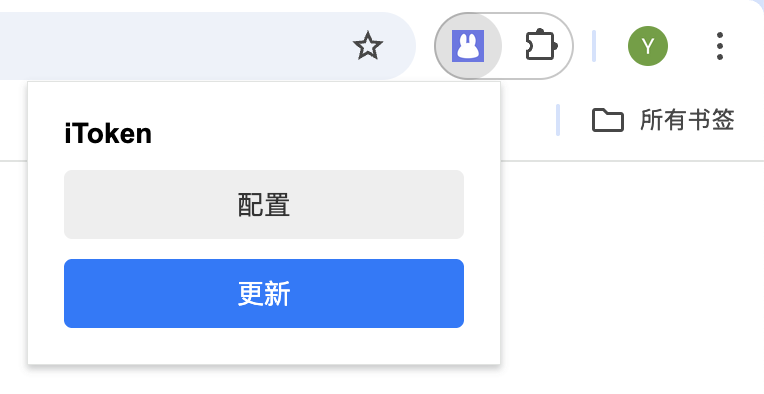
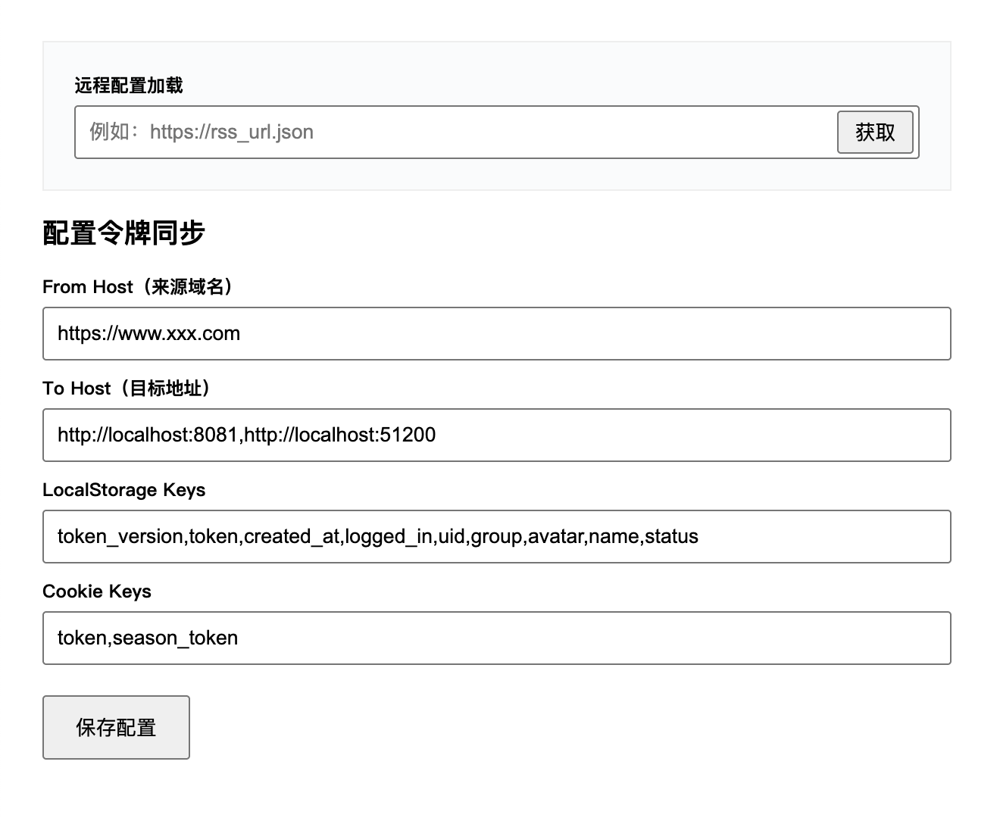

# iToken - Token & Cookie Sync for Chrome Dev

**iToken** is a Chrome extension designed to streamline web development by automatically extracting `token`, `cookie`, and `localStorage` data from live environments and injecting them into your local development environment tabs.

> ⚠️ This extension does **not** currently modify CORS headers due to Chrome Manifest V3 limitations on preflight (`OPTIONS`) requests.

## ✨ Features

- 🔑 Extract `localStorage` and `cookie` values from any online page
- 🔁 Inject token-related data into one or more local `localhost` or custom domain tabs
- ⚙️ Fully configurable: target domains, keys to sync, etc.
- 🧪 Ideal for testing authenticated APIs in local dev environments

## 🧩 How It Works

1. Configure:
   - The **source domain** (where you’re logged in)
   - One or more **target domains** (e.g., `http://localhost:3000`)
   - Keys to extract (e.g., `token`, `session_token`)
2. Click the extension to sync your data
3. Data is automatically injected into all target tabs

## 🛠️ Installation

1. Clone or download this repo
2. Go to `chrome://extensions`
3. Enable "Developer mode"
4. Click "Load unpacked" and select the extension folder
5. Done!

## Local UI preview

Run `npm run dev` from the repository root. No dependency installation is required.

- Settings: http://127.0.0.1:5173/
- Popup: http://127.0.0.1:5173/popup.html

Refresh the page to see changes. The settings preview supports configuration import and export. To save configuration and sync tokens, load `src/` as an unpacked Chrome extension.

Use the **配置文件** menu to import a local JSON file or export the current form values as JSON. Review imported values before saving them.

## Build a release ZIP

Run `npm run build` from the repository root. It uses the system `zip` command and writes `dist/itoken-iruxu.zip`, with `manifest.json` at the archive root. For a release, update the version in `src/manifest.json` before building.

## 📷 Screenshots

**Extension Popup:**

**Options Page:**

## 🚫 Known Limitations

- Cannot modify preflight CORS responses (`OPTIONS` requests)
- Fails silently if the target tab is an error/404 page (e.g., local server not running)

## 💡 Roadmap

- [ ] Optional CORS support via external proxy
- [ ] Support for sessionStorage
- [ ] One-click re-injection on page reload

## 📄 License

MIT License

---

Built with ❤️ by iRuxu
## Team presets (iruxu branch)

Keep the private preset list in the local, Git-ignored `preset/index.json`. Its format is an array of entries such as `{"name":"Local development","config":{"fromHost":"https://example.com","toHost":["http://localhost:51200"],"localStorageKeys":["token"],"cookieKeys":[]}}`.

`npm run dev` reads the local list. `npm run build` embeds it in `dist/itoken-iruxu.zip`. To use presets in Chrome, extract that ZIP and load the extracted folder as an unpacked extension. Share the resulting ZIP only with the intended team.
